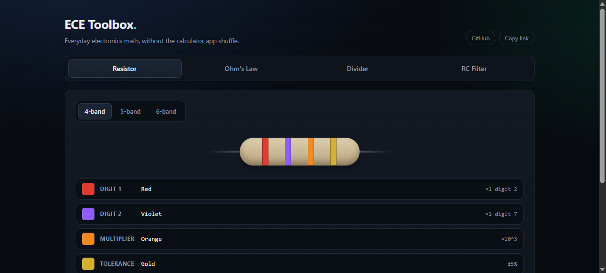
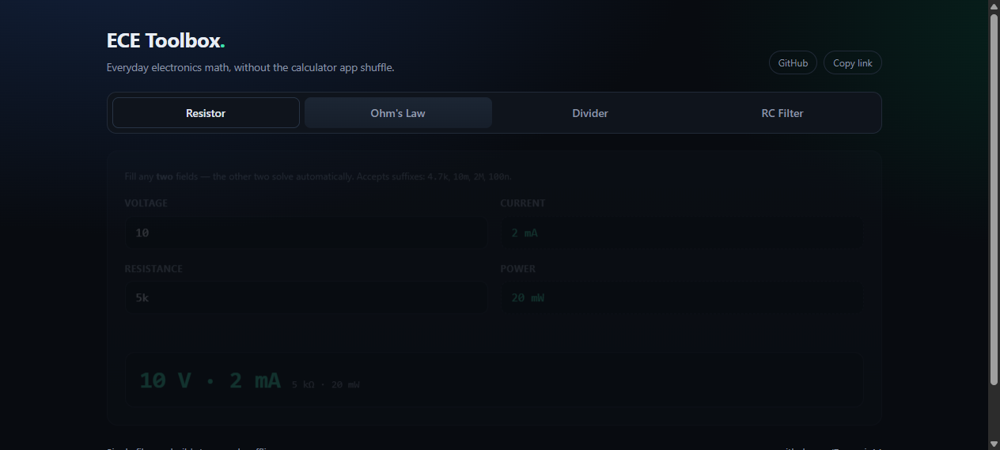
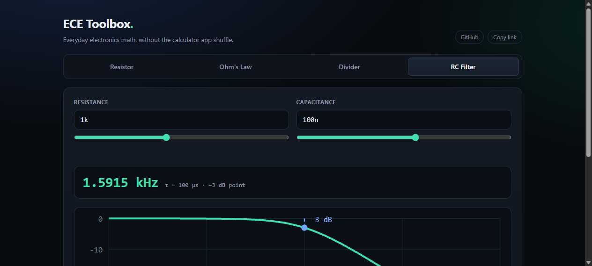

# ECE Toolbox

Interactive calculators for the electronics math you do every week — resistor color codes, Ohm's law, voltage dividers and RC filter cutoffs. One HTML file, no build step, no dependencies, works offline.

**Live:** https://dynamix14.github.io/ece-toolbox/



## What's inside

| Tool | What it does |
|------|--------------|
| **Resistor** | 4, 5 and 6-band color codes. Click a band to cycle its color; value, tolerance and tempco update live. |
| **Ohm's Law** | Fill any two of V, I, R, P — the other two solve automatically. |
| **Divider** | Forward: Vin, R1, R2 → Vout (plus divider current and power). Inverse: pick a target Vout and get the R2 you need, with the nearest E24 value. |
| **RC Filter** | R and C (typed or slider) → cutoff frequency, time constant, and a live magnitude plot with the −3 dB point marked. |

All inputs accept engineering-notation suffixes — `4.7k`, `10m`, `2M`, `100n`, `2.2µ`, `100nF`, `4.7kΩ`. EIA forms like `4k7` are rejected rather than silently misread.





## Why

I kept reaching for a calculator, then a color-code chart, then a scrappy Python snippet for filter cutoffs. This is the one page I wanted open instead: instant, offline, and readable on a phone.

## Run it

```bash
git clone https://github.com/Dynamix14/ece-toolbox.git
cd ece-toolbox
# just open index.html — that's the whole app
```

Or host it anywhere static: GitHub Pages, a USB stick, whatever.

## Tests

The math lives in a marked `CORE` block inside `index.html` and is extracted by a small Node test file — no framework, no install:

```bash
node test/test-core.mjs
```

29 assertions covering the suffix parser, engineering-notation formatting, Ohm's law with zero-resistance guards, resistor values, divider forward/inverse, RC cutoff, and the E24 lookup.

## Notes

- Single file by design: view source, copy, done. ~31 KB unminified.
- Dark UI, responsive down to 360 px.
- Deep-linkable tabs: `#ohm`, `#divider`, `#rc`.
- No tracking, no network calls at runtime.
